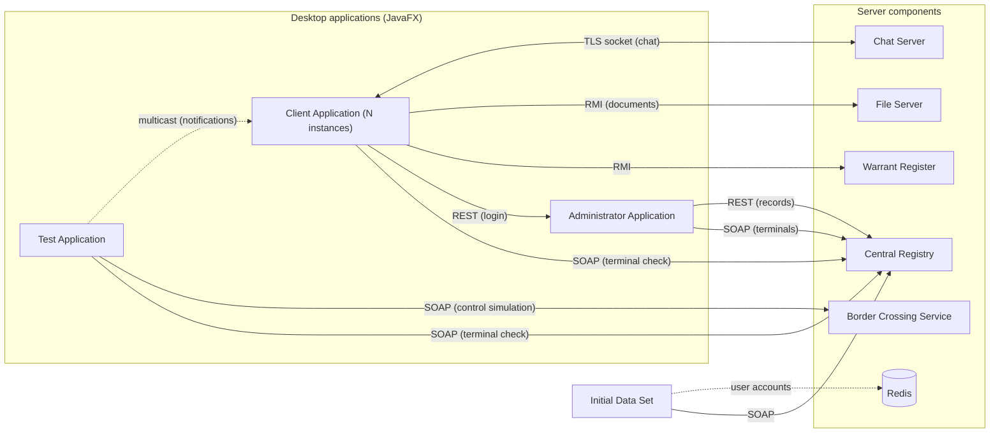

**English** | [Srpski](README.sr.md)

<div align="center">
  <h1>Border Crossing Control and Registration System</h1>
</div>

<!-- Add the 2-3 best screenshots here (e.g. the Client, Administrator and Test applications). -->

A distributed system that simulates passenger registration and control at a state border crossing: managing border terminals, login and on-site work of police/customs staff, warrant checks, and document archiving.
It consists of nine Java applications that communicate over SOAP, REST, RMI, TCP sockets (TLS) and multicast, and is a practical exercise in combining different networking technologies in one system.

## Key features

- **Terminal management:** add, edit, delete and view border terminals, each with any number of entry/exit points that have both police and customs control.
- **Work at an entry/exit point:** the Client Application checks the terminal (SOAP) and the username and password (REST); after login it offers logout, password change and viewing the record of checked passengers.
- **Chat between entry/exit points:** messages to a single entry/exit point, to all entry/exit points of one terminal, or to all entry/exit points in the system, over a TLS connection to the Chat Server.
- **Border crossing simulation:** police control (the person's identifier is checked against the Warrant Register via RMI), multicast notifications about temporary closure of the crossing and resumed work, and document submission at customs (RMI, stored as ZIP).
- **Administration:** management of terminals and user accounts, and download of the records of detected wanted persons and submitted customs documents through a REST service.
- **Security and data:** passwords hashed with PBKDF2WithHmacSHA512 and a salt, TLS for chat, terminals serialized in four formats.

## System architecture



Note: the diagram shows logical communication flows; the exact direction and number of calls depend on the simulation flow.

## Contents

- [System architecture](#system-architecture)
- [System components](#system-components)
- [How the system works](#how-the-system-works)
- [Security](#security)
- [Serialization and data storage](#serialization-and-data-storage)
- [Repository structure](#repository-structure)
- [Running the system](#running-the-system)
- [Test credentials](#test-credentials)
- [Configuration](#configuration)

## System components

| Component | Type | Protocol / technology | Role |
|---|---|---|---|
| **Centralni_Registar** | Web service (server) | SOAP (Apache Axis) + REST (Jersey) | Stores terminals and the records of checked passengers, warrants and submitted documents |
| **Administratorska_Aplikacija** | JavaFX desktop + web module | SOAP client, REST server and client | Terminal CRUD, user account management, viewing warrant/document records |
| **Prelazak_Granice_Servis** | Web service (server) | SOAP (Apache Axis) | Simulates police and customs control at a specific entry/exit point |
| **Chat_Server** | Standalone Java application | TLS (secured socket) | Relays chat messages (unicast/multicast/broadcast) between client applications |
| **File_Server** | Standalone Java application | RMI | Receives, compresses (ZIP) and stores the documents a person submits at customs |
| **Registar_Potjernica** | Standalone Java application | RMI | Checks whether a person's identifier is on the warrant list |
| **Klijentska_Aplikacija** | JavaFX desktop (N instances) | REST, SOAP, RMI, TLS socket, multicast | Work at a specific entry/exit point (police or customs), chat, password change, viewing records |
| **Testna_Aplikacija** | JavaFX desktop | SOAP client, multicast | Simulates a person arriving at and passing through a selected entry/exit point of a terminal |
| **Pocetni_Skup_Podataka** | Standalone Java application | SOAP, Redis | Populates the system with initial data (terminals, user accounts) to make testing easier |
| **Redis** | In-memory database | — | Stores usernames and hashed passwords |

## How the system works

**Terminals.** Each border terminal has a unique integer ID, a name, and any number of entry/exit points, each with both a police and a customs control. Terminals are managed through the Administrator Application (add, edit, delete, view), and the initial terminals are loaded by `Pocetni_Skup_Podataka`. Terminal data is serialized and stored on the Central Registry, one file per terminal.

**Client application login.** When the Client Application starts, the user selects the entry/exit point ID, the control type (police or customs) and the terminal name. The application first checks via SOAP that the terminal exists on the Central Registry, then verifies the username and password through a REST service. After login, a menu offers logout, password change and viewing the record of checked passengers.

**Chat.** Client applications talk to each other through a TLS-secured socket channel to the Chat Server, with three ways of addressing messages: a single entry/exit point, all entry/exit points of one terminal (multicast), and all entry/exit points in the system (broadcast).

**Password change.** User accounts are managed by the Administrator Application, while the Client Application changes the password itself, without going through the Administrator Application.

**Border crossing simulation.** The Test Application simulates a person arriving at a selected entry/exit point. After checking that the terminal exists (SOAP), the simulation first goes through police control: the person's identifier is checked against the Warrant Register via RMI. If the person is wanted, a multicast notification that the crossing is temporarily closed is sent to all entry/exit points of the terminal, until the person has been processed at that police entry/exit point — then the other entry/exit points are notified that work has resumed. If the person passes police control, they submit documents at the customs stage; these are sent via RMI to the File Server and stored there compressed (ZIP).

**Administration.** Besides managing terminals and user accounts, the Administrator Application can download, through a REST service, the records of all detected wanted persons and of the submitted customs documents.

## Security

- **Passwords** are not stored in plain text. They are hashed with **PBKDF2WithHmacSHA512** (10,000 iterations, 256-bit key) using a unique salt per user, and the result is Base64-encoded before it is stored in Redis.
- **Chat communication** goes over TLS (secured socket), using a Java keystore/truststore (`.jks`).
- **Application access:** the Administrator and Client applications require a username and password.

## Serialization and data storage

Following the task requirement to implement at least four serialization methods, terminals on the Central Registry are serialized cyclically through four formats (1st terminal → GSON/JSON, 2nd → Kryo, 3rd → Java native, 4th → XML, 5th → GSON again, and so on), each in its own file (`id_XXX__tip_FORMAT.out`).

All other data is stored separately, according to its nature:

| Data | Format | Location |
|---|---|---|
| Terminals | GSON / Kryo / Java native / XML (rotating) | `Centralni_Registar/.../terminals` |
| Record of checked passengers | text file (append), per terminal | `Centralni_Registar/.../passings` |
| Warrant record (processed persons) | XML | `Centralni_Registar/.../warrants` |
| Submitted documents record (metadata) | XML | `Centralni_Registar/.../documents` |
| Documents submitted by the person | ZIP archive + original files | `File_Server/documents/{terminal}#{prolaz}#{vrijeme}#{redni_broj}` |
| User accounts (credentials) | hashed, key-value form | Redis |

## Repository structure

```
├── Administratorska_Aplikacija/   # JavaFX admin GUI + REST/SOAP web module
├── Centralni_Registar/            # SOAP + REST web service, terminal registry and records
├── Chat_Server/                   # TLS chat server (unicast/multicast/broadcast)
├── File_Server/                   # RMI service for receiving and archiving documents
├── Klijentska_Aplikacija/         # JavaFX client for work at a terminal entry/exit point
├── Pocetni_Skup_Podataka/         # Program for populating initial data
├── Prelazak_Granice_Servis/       # SOAP service for simulating police/customs control
├── Registar_Potjernica/           # RMI service, warrant register
├── Testna_Aplikacija/             # JavaFX application for simulating a border crossing
└── Uputstvo/                      # Task specification, run instructions, notes
```

Each application that runs standalone as a Java application (`Chat_Server`, `File_Server`, `Registar_Potjernica`, `Klijentska_Aplikacija`, `Testna_Aplikacija`, `Pocetni_Skup_Podataka`) has its own `config.properties` file in `resources/properties`, while `Centralni_Registar`, `Administratorska_Aplikacija` and `Prelazak_Granice_Servis` run as web applications on a server (e.g. Apache Tomcat), with Apache Axis for the SOAP part.

## Running the system

The startup order matters because of dependencies between components:

1. **Redis** — start the Redis server (`localhost:6379` by default)
2. **Centralni_Registar** — deploy to the server (e.g. Tomcat)
3. **Pocetni_Skup_Podataka** — run `PocetniPodaci.java` to populate the initial data
4. **Administratorska_Aplikacija** — deploy the web part to the server
5. **Prelazak_Granice_Servis** — deploy to the server
6. **Chat_Server** — run `ChatServer.java`
7. **File_Server** — run `FileServer.java`
8. **Registar_Potjernica** — run `PotjerniceServer.java`
9. **Administratorska_Aplikacija** (desktop part) — run `PokretanjeAdministrator.java`
10. **Klijentska_Aplikacija** — run `PokretanjeKlijent.java`
11. **Testna_Aplikacija** — run `PokretanjeTest.java`

## Test credentials

**Administrator Application**

| Username | Password |
|---|---|
| admin | nimda |

**Client Application**

| Terminal | Entry/exit point | Username | Password | Control |
|---|---|---|---|---|
| AAA | 101 | Ana | anA | police |
| AAA | 101 | Ena | anE | customs |
| AAA | 102 | Ina | anI | police |
| CCC | 105 | Tina | aniT | customs |

**Test Application**

| Terminal | Entry/exit point |
|---|---|
| AAA | 101 |

## Configuration

Parameters (addresses, ports, paths, timeout values, etc.) are set in `config.properties` files. Before running the system on another machine, check and adjust as needed:

- the absolute path to the terminals directory in the `Centralni_Registar` configuration (by default it points to the author's development environment),
- service addresses and ports if components run on different machines (everything runs on `localhost` by default),
- the keystore/truststore passwords used for TLS chat communication.
